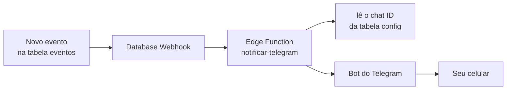

# Alerta no Telegram (opcional)

O ESP32 **não** fala com o Telegram. Ele só grava o evento no Supabase; o Supabase chama uma função
(Edge Function) que manda a mensagem. Sem isto o sistema funciona normalmente: você só não recebe a
mensagem no celular.

## O que tem aqui

| Arquivo | Função |
|---|---|
| `notificar-telegram.ts` | Código da Edge Function (Deno). Monta e envia a mensagem |

## Passo a passo (uns 5 minutos)

1. **Criar o bot:** no Telegram, fale com **@BotFather**, envie `/newbot` e guarde o **token**
   (não compartilhe). Depois abra a conversa com o seu bot e envie `/start`: sem isso ele não
   consegue mandar mensagem para você.
2. **Publicar a função:** no painel do Supabase, *Edge Functions → criar* uma função chamada
   **`notificar-telegram`** (exatamente esse nome), cole o conteúdo de `notificar-telegram.ts` e
   publique (Deploy).
3. **Guardar o token:** em *Edge Functions → Secrets*, adicione `TELEGRAM_BOT_TOKEN` com o token.
   (`SUPABASE_URL` e `SUPABASE_SERVICE_ROLE_KEY` já existem sozinhos.)
4. **Ligar o gatilho:** em *Database → Webhooks → Create a new hook*: tabela `eventos`, evento
   **Insert**, tipo **Supabase Edge Functions**, função `notificar-telegram`.
5. **Dizer para quem mandar:** fale com **@userinfobot**, copie o seu **Id** e cole no site, na
   seção **Alerta no Telegram**, e clique em Salvar.

## Se não chegar a mensagem

Confira: o `/start` no bot, o chat ID, o token no Secret, o webhook criado e os *Logs* da função.

## Adicionando um som novo

Em `notificar-telegram.ts`, no objeto `TEXTOS`, acrescente a frase do novo som (ex.:
`sirene: '🚨 Sirene detectada'`) e publique a função de novo. Veja o
[guia da IA](../../4-ia/GUIA-IA.md#6-adicionar-um-novo-som-checklist).
