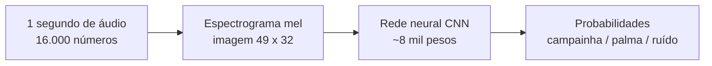

# Guia da IA: como funciona o treino e como adicionar sons

Este guia explica **como a IA do aparelho é criada**, **o que cada parâmetro faz** e **como ensinar um
som novo** (por exemplo, uma sirene). Você não precisa saber programar para seguir o passo a passo,
mas o guia também explica o "porquê" de cada coisa.

> **O modelo já vem treinado** (`modelo/`), então esta pasta é **opcional**: só é preciso para retreinar
> ou adicionar sons. Para instalar e usar o aparelho, ignore a pasta `4-ia`.

## Índice

1. [A ideia em um minuto](#1-a-ideia-em-um-minuto)
2. [Mapa dos arquivos](#2-mapa-dos-arquivos)
3. [A regra de ouro: treino e aparelho calculam igual](#3-a-regra-de-ouro-treino-e-aparelho-calculam-igual)
4. [Configuração: o que cada parâmetro faz](#4-configuração-o-que-cada-parâmetro-faz)
5. [Treinar de novo (dia a dia)](#5-treinar-de-novo-dia-a-dia)
6. [Adicionar um novo som (checklist)](#6-adicionar-um-novo-som-checklist)
7. [Como gravar bons dados](#7-como-gravar-bons-dados)
8. [A rede neural por dentro](#8-a-rede-neural-por-dentro)
9. [Problemas comuns](#9-problemas-comuns)

---

## 1. A ideia em um minuto

Em vez de programar regras ("se o som tem tal frequência..."), mostramos **exemplos** de cada som e o
computador descobre o padrão sozinho (aprendizado de máquina).



- A rede **não ouve o áudio bruto**: ele vira uma "imagem" do som (tempo × frequência). Uma palma é
  uma faixa vertical larga; uma campainha, linhas horizontais constantes.
- A saída são **probabilidades** que somam 100%. O aparelho só avisa se a melhor for palma ou campainha
  **e** tiver 95% ou mais de certeza.
- A classe **`ruido`** existe para a IA aprender o que *não* é alerta (fala, TV, silêncio, rua...).
  Sem ela, a rede seria obrigada a chamar tudo de palma ou campainha.

O treino acontece no **computador**. O resultado (um modelo de 14 KB) é gravado no ESP32, que só
faz a conta de reconhecer, sem internet.

## 2. Mapa dos arquivos

```
4-ia/
├── treino/                 O código (Python)
│   ├── config.py             TODOS os parâmetros num lugar só (classes, áudio, treino)
│   ├── features.py           áudio -> espectrograma mel
│   ├── dados.py              lê os .wav, separa validação, aumenta e balanceia os dados
│   ├── treinar.py            monta, treina e avalia a rede; gera gráficos e relatório
│   ├── exportar.py           reduz para int8, gera os .h e copia para o firmware
│   ├── verificar_firmware.py confere se o cálculo do ESP32 bate com o do treino
│   └── coletar_serial.py     grava sons novos pelo ESP32 (cabo USB) e salva em dados/
├── dados/                  Áudios de 1 s (16 kHz, mono)
│   ├── training/             a IA APRENDE com estes
│   └── testing/              nunca vistos no treino: só para AVALIAR no fim
├── modelo/                 Resultados do último treino
│   ├── modelo_keras.keras      o modelo completo (float32)
│   ├── modelo_alerta.tflite    o modelo reduzido (int8, 14 KB)
│   ├── modelo_tflite.h         o mesmo modelo como código C++ (vai para o ESP32)
│   ├── config_features.h       parâmetros e tabelas do espectrograma (vai para o ESP32)
│   ├── normalizacao.json       média e desvio usados na normalização
│   ├── relatorio_treino.txt    acurácia e matrizes de confusão
│   ├── matriz_confusao.png / grafico_treino.png
│   └── relatorio_exportacao.txt
└── requirements.txt        Bibliotecas Python
```

**Nome dos arquivos de áudio:** o nome começa com a classe, seguido de ponto: `palma.1722345.wav`.
O treino descobre a classe lendo o texto **antes do primeiro ponto**. Por isso o nome de uma classe
**não pode ter ponto, espaço ou acento**.

## 3. A regra de ouro: treino e aparelho calculam igual

O ESP32 calcula o espectrograma com código C++ próprio (`3-aparelho/alerta-sons-ia/ia_sons.h`), enquanto
o treino usa Python (`features.py`). **Os dois precisam produzir exatamente a mesma "imagem"**, senão a IA
vai bem no computador e erra no aparelho.

Para isso:

- Todos os números (janela de Hann, filtros mel, média/desvio, escala do int8, lista de classes) saem do
  `config_features.h`, **gerado automaticamente** pelo `exportar.py`. Nunca edite esse arquivo à mão.
- O `verificar_firmware.py` reproduz o cálculo do ESP32 em Python e compara com o do treino. O esperado é
  diferença máxima de **1** (em escala -128..127) e todas as previsões iguais.
- Rode `verificar_firmware.py` sempre que mexer em algo ligado ao espectrograma.

## 4. Configuração: o que cada parâmetro faz

### 4.1 Parâmetros do treino (`treino/config.py`)

| Parâmetro | Valor | O que faz | Quando mexer |
|---|---|---|---|
| `CLASSES` | `["campainha", "palma", "ruido"]` | Os sons que a IA distingue. **A ordem importa**: é a ordem das saídas da rede e vai para o ESP32 | Ao adicionar um som (seção 6) |
| `TAXA_AMOSTRAGEM` | 16000 | Medições do microfone por segundo | **Não mexer** (igual ao firmware) |
| `AMOSTRAS_POR_CLIPE` | 16000 | Tamanho de cada gravação (1 s) | **Não mexer** |
| `JANELA_FFT` | 512 | Tamanho de cada pedacinho analisado (32 ms). Precisa ser potência de 2 | Só com muito cuidado |
| `SALTO` | 320 | De quantas em quantas amostras começa um pedacinho novo (20 ms) | Só com muito cuidado |
| `BANDAS_MEL` | 32 | Em quantas faixas de frequência o som é dividido | Só com muito cuidado |
| `FREQ_MIN` / `FREQ_MAX` | 80 / 8000 Hz | Faixa de frequências consideradas | Só com muito cuidado |
| `FRACAO_VALIDACAO` | 0.15 | % dos áudios de treino reservados para checar se a IA está aprendendo ou decorando | Raramente |
| `AMOSTRAS_POR_CLASSE` | 1500 | Quantos exemplos cada classe terá **depois** do aumento de dados | Se tiver muito mais áudios reais |
| `EPOCAS_MAXIMAS` | 80 | Máximo de passadas completas pelos dados (para antes, se parar de melhorar) | Raramente |
| `TAMANHO_LOTE` | 32 | A rede ajusta os pesos a cada 32 exemplos | Raramente |
| `TAXA_APRENDIZADO` | 0.001 | "Tamanho do passo" do ajuste dos pesos | Se o treino oscilar ou ficar muito lento |
| `SEMENTE` | 42 | Fixa o sorteio: o mesmo treino dá o mesmo resultado | Para variar o resultado |

**Mudar `JANELA_FFT`, `SALTO` ou `BANDAS_MEL` altera o tamanho da "imagem"** (`N_QUADROS × BANDAS_MEL`)
e quebra o treino atual, porque a camada `Reshape` da rede tem tamanho fixo (6×4×32). Se precisar mexer,
ajuste também o `Reshape` em `treinar.py` e refaça todo o fluxo (treinar, exportar, verificar, gravar).

### 4.2 Parâmetros do aparelho (`3-aparelho/alerta-sons-ia/alerta-sons-ia.ino`)

| Parâmetro | Valor | O que faz |
|---|---|---|
| `CONFIANCA_MIN` | 0.95 | Certeza mínima para disparar. Suba se houver falsos alertas, desça se perder sons reais |
| `COOLDOWN` | 5000 ms | Tempo mínimo entre dois avisos, para não repetir |
| `PASSO_JANELA` | 4000 amostras | A IA analisa o último 1 s a cada 250 ms (janela deslizante) |
| `DESLOC` / `GANHO` | 16 / 1 | Ajuste de volume do microfone. **Têm de ser iguais aos da época em que os áudios de treino foram gravados**, senão o aparelho "ouve" mais baixo ou mais alto do que a IA aprendeu |
| `IA_TAMANHO_ARENA` (`ia_sons.h`) | 24 KB | Memória de trabalho da rede. O Serial mostra quanto foi usado; aumente se faltar |

> **Dica:** use o comando `l 1` no Serial Monitor para ver as probabilidades em tempo real antes de
> mexer em `CONFIANCA_MIN`.

### 4.3 O que o treino faz com os dados (resumo)

1. **Carrega** os `.wav` de `dados/training` e `dados/testing` (ignora arquivos de classes que não
   estão em `CLASSES`).
2. **Separa a validação** (15% de cada classe) **antes** de criar variações, para nenhuma cópia de um
   áudio de treino vazar para a validação (isso daria um resultado falsamente bom).
3. **Aumenta e balanceia** o treino até 1.500 exemplos por classe, criando variações: deslocamento no
   tempo (±0,2 s), volume diferente (0,4x a 1,6x) e mistura com ruído de fundo. Sem balancear, a IA
   aprenderia a "chutar ruído" porque há mais exemplos dele. A classe `ruido` ainda recebe versões em
   volume baixo e ruído artificial fraco (incluindo silêncio), para não disparar em sala quieta.
4. **Calcula os espectrogramas** e a **normalização** `(x - média) / desvio`. Média e desvio vêm só do
   treino e são os mesmos usados no ESP32.
5. **Treina** a rede com parada antecipada (*early stopping*): para quando a validação deixa de melhorar
   e volta aos melhores pesos.
6. **Avalia** no `testing` (áudios que a rede nunca viu) e faz um teste de volume baixo nos ruídos.
7. **Salva** modelo, normalização e relatórios em `modelo/`.

## 5. Treinar de novo (dia a dia)

Todos os comandos são rodados dentro da pasta `4-ia`, no PowerShell.

**Uma vez só — preparar o Python** (precisa do **Python 3.12**; ou use a opção 4 do `setup.bat`):

```powershell
python -m venv .venv
.\.venv\Scripts\python.exe -m pip install -r requirements.txt
```

**Cada vez que quiser retreinar:**

```powershell
# (opcional) gravar sons novos com o ESP32 ligado no USB. Feche o Serial Monitor antes!
.\.venv\Scripts\python.exe treino\coletar_serial.py COM3 palma 30
.\.venv\Scripts\python.exe treino\coletar_serial.py COM3 campainha 30
.\.venv\Scripts\python.exe treino\coletar_serial.py COM3 ruido 60

.\.venv\Scripts\python.exe treino\treinar.py            # treina e avalia
.\.venv\Scripts\python.exe treino\exportar.py           # reduz, gera os .h e copia para o firmware
.\.venv\Scripts\python.exe treino\verificar_firmware.py # confere o cálculo do ESP32
```

Depois abra o `.ino` na Arduino IDE e **grave de novo no ESP32**. Teste com `l 1`.

`COM3` é a porta do ESP32 (Arduino IDE → Ferramentas → Porta). O número final é a quantidade de
gravações de 1 segundo. A cada 5 gravações, 1 vai para `testing` (20%) e as demais para `training`.

**Como ler o resultado** (`modelo/relatorio_treino.txt` e `matriz_confusao.png`):

- **Acurácia no TESTE** é a nota que importa (a de validação é só um acompanhamento). Hoje: 92,5% (float)
  e 90% (int8, o que roda no ESP32). Uma queda pequena do float para o int8 é normal.
- **Matriz de confusão:** cada linha é o som real e cada coluna o que a IA respondeu. Números fora da
  diagonal são erros. Vale olhar *quais* sons se confundem (ex.: palma classificada como ruído).
- **Revocação** = dos sons reais daquela classe, quantos a IA achou. **Precisão** = das vezes em que ela
  disse aquela classe, quantas estavam certas.
- **Teste de volume baixo:** ruídos em volume reduzido devem continuar sendo `ruido`. Falhas aqui viram
  falsos alertas em sala silenciosa.

## 6. Adicionar um novo som (checklist)

Adicionar uma classe quase não pesa no ESP32: cada classe nova acrescenta só ~768 pesos na última camada.

**O que muda e o que não muda:**

| Parte | Muda? | Por quê |
|---|---|---|
| Banco (Supabase) | **Não** | A coluna `tipo` aceita qualquer texto |
| Treino (`config.py`) | Sim | Declarar a classe |
| Coleta (`coletar_serial.py` + `.ino`) | Sim | Ensinar a gravar a classe nova |
| Firmware (`.ino`) | Sim | Aceitar o tipo e escolher a cor do LED |
| Site (`app.vue`) | Sim | Ícone, filtro e cor do alerta |
| Telegram (função) | Sim | Texto da mensagem |

Vamos usar **`sirene`** como exemplo e a letra **`i`** como comando de gravação. As letras `c`, `p`, `r`,
`s`, `l`, `w`, `m` e `h` já têm uso; escolha uma letra livre.

> **Regras do nome:** minúsculas, **sem acento, espaço ou ponto**, com no máximo **15 caracteres**
> (o firmware guarda o tipo num texto de 16 posições).

### Passo 1 · Ensinar o ESP32 a gravar a classe nova

Em `3-aparelho/alerta-sons-ia/alerta-sons-ia.ino`, no trecho `processarComando`, acrescente a letra `i`:

```cpp
if (nome == "c" || nome == "p" || nome == "r" || nome == "i") {
  ...
  const char* label = (nome == "c") ? "campainha" : (nome == "p") ? "palma"
                    : (nome == "i") ? "sirene" : "ruido";
```

E, em `mostrarAjuda()`, a linha: `Serial.println("i N        = gravar N amostras de sirene (enviadas ao PC pelo USB)");`

### Passo 2 · Ensinar o script de coleta

Em `4-ia/treino/coletar_serial.py`:

```python
letra = {"campainha": "c", "palma": "p", "ruido": "r", "sirene": "i"}[classe]
```

### Passo 3 · Declarar a classe no treino

Em `4-ia/treino/config.py`:

```python
CLASSES = ["campainha", "palma", "sirene", "ruido"]
```

A rede (camada final), o `exportar.py` e o `config_features.h` (`IA_CLASSES`, `IA_N_CLASSES`) se ajustam
sozinhos. **`ruido` precisa continuar na lista** (o treino usa ele para as variações).

### Passo 4 · Gravar o firmware de coleta e gravar os sons

Grave o `.ino` do passo 1 no ESP32. Depois, com o Serial Monitor **fechado**:

```powershell
.\.venv\Scripts\python.exe treino\coletar_serial.py COM3 sirene 40
```

Grave **40 a 50 amostras**, variando distância, volume e local (veja a [seção 7](#7-como-gravar-bons-dados)).
Grave também **ruídos parecidos** com a sirene (fala, TV, música, buzina) na classe `ruido`, para a IA
aprender a diferença.

### Passo 5 · Treinar, exportar e conferir

```powershell
.\.venv\Scripts\python.exe treino\treinar.py
.\.venv\Scripts\python.exe treino\exportar.py
.\.venv\Scripts\python.exe treino\verificar_firmware.py
```

Olhe a matriz de confusão. Se a sirene for muito confundida com campainha, grave mais exemplos de cada.
Se ainda assim não melhorar, dá para aumentar os filtros das camadas em `treinar.py` (custa algumas dezenas
de KB; confira a arena no Serial). O `exportar.py` já copia os `.h` para `3-aparelho/alerta-sons-ia/`.

### Passo 6 · Fazer o ESP32 reagir à nova classe

No `.ino`:

**a)** Em `tratarDeteccao`, aceite o novo tipo (senão a classe é ignorada, como o `ruido`):

```cpp
else if (strcasecmp(label, "sirene") == 0) tipo = "sirene";
```

**b)** Em `tarefaAcoes`, escolha uma cor para o LED. Hoje só distingue palma de campainha; troque por:

```cpp
if (strcmp(ev.tipo, "palma") == 0)          piscar(255, 0, 0, 3, 120);     // vermelho
else if (strcmp(ev.tipo, "sirene") == 0)    piscar(160, 0, 255, 3, 120);   // roxo
else                                        piscar(255, 180, 0, 3, 120);   // amarelo
```

Grave o ESP32 de novo.

### Passo 7 · Site e Telegram

**Site** (`2-site/app/app.vue`):

- Em `ICONES`, acrescente `sirene: '🚨',`.
- No filtro de tipo, acrescente `<option value="sirene">Sirene</option>`.
- No CSS, a cor do alerta em tela: `.flash.sirene { background: #7c3aed; color: #fff; }`.

**Telegram** (`1-banco/telegram/notificar-telegram.ts`): em `TEXTOS`, acrescente
`sirene: '🚨 Sirene detectada',` e publique a função de novo (cole no editor de Edge Functions e Deploy).

### Passo 8 · Testar

Com `l 1` ligado, toque uma sirene perto do microfone e veja `sirene=0.9x` subir. Depois confira `s 1`,
o LED roxo, o alerta no site e a mensagem no Telegram.

**Resumo de onde mexer:**

| Arquivo | O que acrescentar |
|---|---|
| `3-aparelho/.../alerta-sons-ia.ino` | letra de gravação (passo 1), aceitar o tipo e cor do LED (passo 6) |
| `4-ia/treino/coletar_serial.py` | a letra no dicionário (passo 2) |
| `4-ia/treino/config.py` | nome em `CLASSES` (passo 3) |
| `2-site/app/app.vue` | ícone, opção do filtro e cor (passo 7) |
| `1-banco/telegram/notificar-telegram.ts` | texto da mensagem (passo 7) |

## 7. Como gravar bons dados

A qualidade dos exemplos pesa mais do que qualquer ajuste de parâmetro.

- **Quantidade mínima:** 40 a 50 gravações por som novo. Com poucos exemplos o aumento de dados só
  repete o que existe e a IA decora (*overfitting*). Hoje o projeto tem 70 palmas e 80 campainhas.
- **Variedade:** distâncias, volumes e locais diferentes; fontes diferentes (uma sirene tocando no
  celular, outra no computador); o aparelho na mão, no bolso e na bolsa.
- **Ruído de verdade:** grave `ruido` nos ambientes onde o aparelho vai ficar: sala quieta, TV ligada,
  conversa, ventilador, rua. Os primeiros ruídos do projeto eram todos de ambientes barulhentos e o modelo
  disparava em sala silenciosa, por isso hoje o treino também cria ruído fraco artificial.
- **Pegadinhas:** grave como `ruido` os sons que *poderiam* ser confundidos com o alerta (palma de longe,
  batida na porta, toque de celular, música).
- **Fique em silêncio** durante a coleta de `ruido` e faça o som **durante todo o segundo** nas outras
  classes. O LED mostra: roxo = prepare-se, **branco = gravando agora**, azul = enviando, verde = ok.
- **Os áudios precisam ter 1 s, 16 kHz, mono**: o `coletar_serial.py` já grava assim.
- **Mantenha o ganho do microfone** (`DESLOC`/`GANHO` no `.ino`). Se mudar, regrave tudo.

## 8. A rede neural por dentro

A rede é uma CNN pequena (cerca de 8 mil pesos, 14 KB depois do int8), definida em `criar_modelo()` em
`treinar.py`:

| Camada | O que faz |
|---|---|
| Entrada 49×32×1 | O espectrograma, como uma foto em preto e branco |
| Conv2D 8 filtros + MaxPooling | Acha padrões simples (bordas, linhas) e reduz a imagem (24×16) |
| Conv2D 16 filtros + MaxPooling | Combina em padrões maiores (12×8) |
| Conv2D 32 filtros + MaxPooling | Padrões ainda mais complexos (6×4) |
| Reshape (768) | "Estica" a imagem num vetor |
| Dropout 30% | Só no treino: desliga neurônios ao acaso para não decorar |
| Dense (N classes) + softmax | Transforma em probabilidades, uma por classe |

**Limite importante:** o firmware só registra as operações `Conv2D`, `MaxPool2D`, `Reshape`,
`FullyConnected` e `Softmax` (`ia_sons.h`, em `MicroMutableOpResolver`). Se você trocar a arquitetura e
usar outra camada (BatchNormalization, outra ativação, etc.), o modelo vai treinar normalmente mas o
ESP32 falhará ao iniciar. Nesse caso é preciso adicionar a operação no resolver (ex.: `resolver.AddXxx()`
e aumentar o número em `MicroMutableOpResolver<5>`).

**Quantização int8 (`exportar.py`):** os pesos viram inteiros de 8 bits. O arquivo fica ~4× menor e mais
rápido. O conversor usa exemplos reais (`representativos`) para escolher a escala de cada camada.

## 9. Problemas comuns

| Sintoma | Causa provável | O que fazer |
|---|---|---|
| `python` não encontrado | Python não instalado | Instale o Python 3.12 (python.org) e marque "Add to PATH"; ou use a opção 4 do `setup.bat` |
| Erro de TensorFlow ao instalar | Versão do Python | Use o Python **3.12** |
| `coletar_serial.py` diz "Acesso negado" | Serial Monitor aberto | Feche o Serial Monitor (só um programa usa a porta COM) |
| Treino dá erro `tamanho inesperado` | Algum `.wav` não tem 1 s / 16 kHz | Regrave com o `coletar_serial.py` ou remova o arquivo |
| Classe nova não aparece no treino | Nome do arquivo não começa com a classe, ou classe fora de `CLASSES` | Confira o nome (`sirene.123.wav`) e o `config.py` |
| Funciona no PC e erra no aparelho | Cálculo diferente ou ganho do microfone diferente | Rode `verificar_firmware.py`; confira `DESLOC`/`GANHO` e se copiou os `.h` novos |
| Muitos falsos alertas | Pouco `ruido` real ou limiar baixo | Grave mais `ruido` do ambiente e retreine; suba `CONFIANCA_MIN` |
| Não detecta o som | Poucos exemplos ou limiar alto | Grave mais exemplos variados; desça `CONFIANCA_MIN` |
| Uma classe é confundida com outra | Exemplos parecidos ou poucos | Grave mais das duas, em condições variadas |
| ESP32 trava ao iniciar após trocar o modelo | Arena pequena ou operação não registrada | Veja o Serial; aumente `IA_TAMANHO_ARENA` ou registre a operação (seção 8) |
| Acurácia do int8 bem abaixo do float | Poucos dados representativos | Mais dados de treino; rode `exportar.py` de novo |
