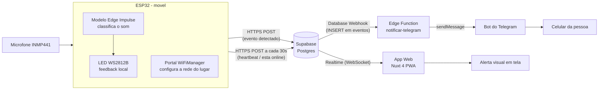

# Alerta de Sons ESP32

Sistema de acessibilidade: um ESP32 com microfone detecta sons (campainha,
palma) usando um modelo do Edge Impulse e manda o evento para o Supabase.
Um app web (PWA em Nuxt 4) mostra, em tempo real, um alerta visual gigante
em tela (icone + texto grande + flash), junto com historico e status de
cada ESP32 (online/offline).

## Como o sistema funciona (visão geral)



1. O microfone (INMP441, via I2S) captura áudio continuamente no ESP32.
2. O modelo treinado no Edge Impulse classifica cada janela de áudio como
   `palma`, `campainha` ou `ruído`.
3. Ao detectar `palma` ou `campainha` com confiança suficiente, o ESP32
   grava o evento na tabela `eventos` do Supabase (via HTTPS/REST) e pisca
   o LED local.
4. A cada 30 segundos, o ESP32 também atualiza a tabela `nodes` com um
   "sinal de vida" (heartbeat), independente de ter detectado som ou não.
5. O Supabase distribui essas mudanças em tempo real (Realtime, via
   WebSocket) para quem estiver com o app aberto, e também dispara um
   Database Webhook para uma Edge Function sempre que um evento é inserido.
6. O app web (PWA em Nuxt) escuta o canal em tempo real e, ao chegar um
   evento: pisca a tela inteira com ícone e texto grande, guarda no
   histórico e atualiza o status online/offline do nó.
7. A Edge Function manda a mesma informação como mensagem para o bot do
   Telegram, que entrega no celular da pessoa — mesmo se ela não estiver
   olhando para o app web naquele momento.
8. Como o ESP32 é levado para lugares diferentes, ele não tem mais uma
   rede WiFi fixa no código: usa um portal de configuração (WiFiManager)
   para aprender a rede de cada lugar.

## Tecnologias usadas

- **ESP32 + Arduino/C++**: leitura do microfone via I2S, controle do LED
  WS2812B, portal de configuração de WiFi (WiFiManager) e comunicação
  HTTPS com o Supabase.
- **Edge Impulse**: treinamento e inferência do modelo de classificação de
  som (embarcado no firmware via a biblioteca `alerta-sons_inferencing`).
- **Supabase**: banco Postgres gerenciado, API REST automática (PostgREST),
  Realtime (WebSocket), Row Level Security (RLS), Database Webhooks e
  Edge Functions (Deno).
- **Telegram Bot API**: entrega do alerta como notificação no celular.
- **Nuxt 4 (Vue 3)**: framework do app web, como PWA (`@vite-pwa/nuxt`).
- **TypeScript**: tipagem do código do app web.
- **pnpm/npm**: gerenciador de pacotes do app web.

## Estrutura do projeto

- `firmware/alerta-sons-esp32.ino`: codigo do ESP32 (Arduino).
- `app/app.vue`: tela principal do app web.
- `plugins/supabase.client.ts`: cliente do Supabase usado pelo app.
- `supabase/schema.sql`: script para configurar o banco no Supabase.
- `supabase/functions/notificar-telegram/`: Edge Function que manda o
  alerta para o Telegram.

## 1. Configurar o Supabase (passo a passo)

Você já criou o projeto no Supabase, agora falta só isso:

1. Entre no painel do seu projeto em [supabase.com](https://supabase.com).
2. No menu lateral, abra **SQL Editor** e clique em **New query**.
3. Cole todo o conteúdo do arquivo `supabase/schema.sql` deste repositório e
   clique em **Run**. Isso cria as tabelas `eventos` e `nodes`, libera o
   acesso necessário e ativa o tempo real.
4. Vá em **Project Settings -> Data API** (ou **API** em versões mais
   antigas) e copie:
   - o **Project URL**;
   - a chave **anon public** (nunca a `service_role`).

Esses dois valores são usados tanto no app web quanto no firmware do ESP32.

## 2. Configurar o app web

Crie um arquivo `.env` na raiz do projeto (copie de `.env.example`):

```bash
NUXT_PUBLIC_SUPABASE_URL=https://<seu-projeto>.supabase.co
NUXT_PUBLIC_SUPABASE_KEY=<chave anon/publishable>
```

Instale as dependências e suba o app:

```bash
pnpm install
pnpm dev
```

O app abre em `http://localhost:3000`.

> Requer Node.js 22 ou superior para `pnpm build` funcionar sem erros
> (algumas dependências usam recursos novos do JavaScript). `pnpm dev`
> funciona normalmente em versões mais antigas.

## 3. Configurar o firmware do ESP32

Na Arduino IDE, instale a biblioteca **WiFiManager** (de *tzapu*): menu
**Sketch -> Include Library -> Manage Libraries**, procure por
"WiFiManager" e instale.

Abra `firmware/alerta-sons-esp32.ino` e preencha, no topo do arquivo:

- `SUPABASE_URL` / `SUPABASE_KEY`: os mesmos valores do passo 1;
- `NODE_ID`: um nome único para esse ESP32 (ex.: `"no1"`, `"porta"`).

O WiFi **não** é mais fixo no código (o dispositivo é móvel). Grave o
firmware e, na primeira vez (ou depois de enviar `w` pelo monitor serial),
o ESP32 cria uma rede própria chamada **AlertaSons-Setup**. Conecte o
celular nela, uma página deve abrir sozinha (ou acesse `192.168.4.1`),
escolha a rede WiFi do lugar e a senha. Isso fica salvo no próprio ESP32;
quando levar o dispositivo para outro lugar, basta enviar `w` de novo.

No monitor serial, envie `s 1` para ligar o envio dos eventos ao Supabase
(por padrão ele começa desligado).

O firmware manda, a cada 30 segundos, um "sinal de vida" para a tabela
`nodes` (independente de detectar som ou não), o que permite ao app saber
se aquele ESP32 está online.

## 4. Configurar o alerta no Telegram

O ESP32 não fala com o Telegram diretamente — ele só grava o evento no
Supabase, como sempre. Quem manda a mensagem é uma Edge Function do
Supabase, disparada automaticamente a cada evento novo.

### 4.1. Criar o bot no Telegram

1. No Telegram, procure por **@BotFather** e envie `/newbot`.
2. Escolha um nome e um usuário para o bot (precisa terminar em `bot`).
3. O BotFather devolve um **token** (algo como `123456:ABC-DEF...`).
   Guarde esse token.

### 4.2. Publicar a Edge Function

1. No painel do Supabase, abra **Edge Functions** e crie uma nova função
   chamada `notificar-telegram`.
2. Cole o conteúdo de `supabase/functions/notificar-telegram/index.ts`
   deste repositório e publique.
3. Em **Edge Functions -> Secrets**, adicione `TELEGRAM_BOT_TOKEN` com o
   token do passo 4.1 (`SUPABASE_URL` e `SUPABASE_SERVICE_ROLE_KEY` já
   existem por padrão em todo projeto).

### 4.3. Ligar o aviso automático (Database Webhook)

1. Rode (de novo, se ainda não rodou) o `supabase/schema.sql` atualizado
   — ele cria a tabela `config`, usada para guardar o chat ID.
2. No painel, vá em **Database -> Webhooks -> Create a new hook**.
3. Tabela: `eventos`. Evento: `INSERT`. Tipo: **Supabase Edge Functions**.
   Função: `notificar-telegram`.
4. Salve. A partir de agora, todo evento novo chama a função automaticamente.

### 4.4. A pessoa liga o Telegram dela (pelo app web)

1. No Telegram, a pessoa fala com **@userinfobot** e copia o número que
   ele responde (o "Id" dela).
2. No app web, na seção **Alerta no Telegram**, cola esse número e clica
   em **Salvar**.
3. Pronto — o próximo som detectado chega tanto na tela quanto no
   Telegram do celular.

## Como funciona o gerenciamento no app

- **Alerta em tela**: ao chegar um evento, a tela inteira pisca com um
  ícone e um texto enorme (campainha ou palma), sem depender só de cor.
- **Histórico**: lista os últimos eventos, com filtro por tipo e por nó.
- **Marcar como visto**: cada evento pode ser marcado como visto, para
  diferenciar do que ainda não foi notado.
- **Status por nó**: mostra se cada ESP32 está online ou offline, com base
  no heartbeat.
- **Alerta no Telegram**: a pessoa cola o próprio chat ID uma vez e passa
  a receber o mesmo alerta no celular, mesmo longe da tela.
