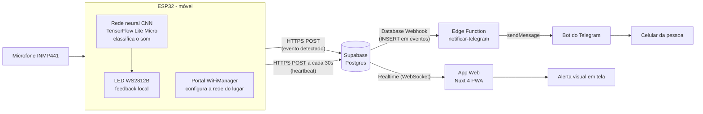

# Alerta de Sons ESP32

Dispositivo de acessibilidade para pessoas com deficiência auditiva. Um ESP32 com microfone
escuta o ambiente, reconhece **palma** e **campainha** com uma rede neural treinada por nós
(rodando no próprio aparelho, sem internet para reconhecer) e avisa a pessoa por **LED**, por um
**app web** em tempo real e por **mensagem no Telegram**.

O aparelho é móvel: pensado para ir no bolso, usando o hotspot do celular e um powerbank.

## Por onde começar

**Dê dois cliques em [`setup.bat`](setup.bat).** O assistente confere o que falta instalar, pede
os dados do Supabase, testa a conexão e cria os arquivos de configuração do site e do aparelho.
(Sem Windows: `node setup.mjs`.)

Depois, em ordem:

| # | Pasta | O que é | Obrigatório? | Leia |
|---|---|---|---|---|
| 1 | [`1-banco/`](1-banco/) | Banco de dados na nuvem (Supabase) e alerta do Telegram | Sim | [1-banco/README.md](1-banco/README.md) |
| 2 | [`2-site/`](2-site/) | App web (Nuxt): alerta em tela, histórico, status | Sim | [2-site/README.md](2-site/README.md) |
| 3 | [`3-aparelho/`](3-aparelho/) | Firmware do ESP32 (Arduino) | Sim | [3-aparelho/README.md](3-aparelho/README.md) |
| 4 | [`4-ia/`](4-ia/) | Treino da rede neural (Python). **O modelo já vem treinado** | Só para retreinar ou adicionar sons | [4-ia/GUIA-IA.md](4-ia/GUIA-IA.md) |
| — | [`docs/`](docs/) | Manual completo, diagramas e ligação das peças | Consulta | [docs/MANUAL.md](docs/MANUAL.md) |

> Só quer instalar e usar? Basta o **setup.bat** e as pastas **1, 2 e 3**. A pasta 4 pode ser ignorada.

## O que precisa ser configurado

Só **três valores**, e o `setup.bat` coloca cada um no lugar certo:

| Valor | Onde conseguir | Onde é usado |
|---|---|---|
| URL do projeto Supabase | Painel → Project Settings → Data API | `2-site/.env` e `3-aparelho/alerta-sons-ia/secrets.h` |
| Chave anon / publishable | Painel → Project Settings → Data API | os mesmos dois arquivos |
| Nome do aparelho (`no1`, `no2`...) | Você escolhe | `secrets.h` |
| *(opcional)* Token do bot do Telegram | @BotFather | Secret da Edge Function ([1-banco/telegram](1-banco/telegram/README.md)) |

Os arquivos `.env` e `secrets.h` ficam **só no seu computador** (estão no `.gitignore`). Os modelos
`.env.example` e `secrets.h.example` mostram o formato.

## Como o sistema funciona



1. O microfone (INMP441, via I2S) captura áudio continuamente a 16 kHz.
2. A cada 250 ms o ESP32 transforma o último 1 s de áudio num espectrograma mel e a rede neural
   classifica como `palma`, `campainha` ou `ruido`.
3. Se for palma ou campainha com confiança alta (padrão 95%), o LED acende e o evento é gravado
   na tabela `eventos` do Supabase. **Nenhum áudio sai do aparelho**, só o evento.
4. A cada 30 s o ESP32 atualiza a tabela `nodes` (heartbeat), o que indica que está online.
5. O Supabase repassa o evento em tempo real ao app web e dispara a Edge Function do Telegram.
6. Como o ESP32 muda de lugar, o Wi-Fi não fica fixo no código: o portal WiFiManager (rede
   `AlertaSons-Setup`) permite escolher a rede de cada lugar.

Mais diagramas (coleta e treino, firmware, nuvem) em [docs/DIAGRAMAS.md](docs/DIAGRAMAS.md).

## Mapa dos arquivos

```
alerta-sons-esp32/
├── setup.bat / setup.mjs        Assistente de configuração (dois cliques)
├── 1-banco/
│   ├── schema.sql                 Cria as tabelas eventos, nodes e config no Supabase
│   └── telegram/                  (opcional) Edge Function que manda o alerta ao Telegram
├── 2-site/                      App web Nuxt 4 (app/app.vue é a tela inteira)
│   └── .env.example               modelo da configuração do site
├── 3-aparelho/
│   └── alerta-sons-ia/            Sketch do Arduino
│       ├── alerta-sons-ia.ino       programa principal (Wi-Fi, Supabase, LED, comandos)
│       ├── ia_sons.h                espectrograma + execução da rede neural
│       ├── modelo_tflite.h          o modelo treinado (gerado, não editar)
│       ├── config_features.h        tabelas e parâmetros do espectrograma (gerado)
│       └── secrets.h.example        modelo da configuração do aparelho
├── 4-ia/                        Treino da IA (opcional)
│   ├── treino/                    scripts Python (config, features, dados, treinar, exportar...)
│   ├── dados/                     áudios gravados: training/ e testing/
│   ├── modelo/                    modelo treinado, gráficos e relatórios
│   └── GUIA-IA.md                 como funciona o treino e como adicionar sons
└── docs/                        MANUAL.md e DIAGRAMAS.md
```

## Tecnologias

- **ESP32 + Arduino/C++**: microfone I2S, LED WS2812B, WiFiManager, HTTPS com o Supabase.
- **Python + TensorFlow/Keras**: treino da CNN; exportação para TensorFlow Lite (int8, ~14 KB).
- **TensorFlow Lite Micro**: roda o modelo no ESP32 (biblioteca `Chirale_TensorFLowLite`).
- **Supabase**: Postgres, API REST, Realtime, RLS, Database Webhooks e Edge Functions (Deno).
- **Telegram Bot API**: notificação no celular.
- **Nuxt 4 (Vue 3) + TypeScript**: app web como PWA.

## Resultado do modelo

Avaliado em áudios que a rede nunca viu (`4-ia/dados/testing`): **92,5%** de acerto no modelo float
e **90,0%** no modelo int8 que roda no ESP32. Detalhes e matriz de confusão em `4-ia/modelo/`.

## Limitações conhecidas

- **Segurança:** as regras do banco deixam qualquer pessoa com a chave pública ler, inserir e apagar
  eventos. Serve para o projeto de estudo; para uso real seria preciso login (Supabase Auth).
- **Dados de treino:** são poucos (70 palmas, 80 campainhas) e de um só ambiente. Gravar mais sons
  reais é a melhor forma de melhorar a IA ([guia](4-ia/GUIA-IA.md)).
- **Telegram:** envia para uma única conversa.
