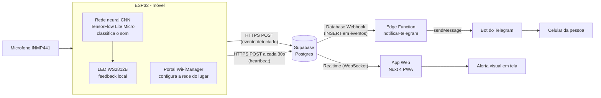

# Alerta de Sons ESP32

Dispositivo de acessibilidade para pessoas com deficiência auditiva. Um ESP32 com
microfone escuta o ambiente, reconhece **palma** e **campainha** com uma rede neural
treinada por nós (rodando no próprio aparelho, sem internet para reconhecer) e avisa a
pessoa por LED, por um app web em tempo real e por mensagem no Telegram.

O aparelho é móvel: pensado para ser levado no bolso, usando o hotspot do celular da
pessoa e um powerbank.

> **Primeira vez aqui?** Siga o [**manual completo**](docs/MANUAL.md): montagem, Supabase,
> site, Telegram, treino da IA e como adicionar novos sons, tudo em um arquivo.

## Como o sistema funciona



1. O microfone (INMP441, via I2S) captura áudio continuamente a 16 kHz.
2. A cada 250 ms o ESP32 transforma o último 1 s de áudio num espectrograma mel e a
   rede neural classifica como `palma`, `campainha` ou `ruido`.
3. Se for palma ou campainha com confiança alta (padrão 95%), o LED acende e o evento é
   gravado na tabela `eventos` do Supabase. Nenhum áudio sai do aparelho, só o evento.
4. A cada 30 s o ESP32 atualiza a tabela `nodes` (heartbeat), o que indica que está online.
5. O Supabase repassa o evento em tempo real ao app web e dispara uma Edge Function que
   envia a mensagem no Telegram.
6. Como o ESP32 muda de lugar, a rede Wi-Fi não fica fixa no código: o portal
   WiFiManager (rede `AlertaSons-Setup`) permite escolher a rede de cada lugar.

Mais diagramas (coleta e treino, firmware, nuvem) em [docs/DIAGRAMAS.md](docs/DIAGRAMAS.md).

## Estrutura do repositório

```
ia/                      Treino da rede neural (Python) - ver ia/README.md
  treino/                  código: features, dados, treino, exportação, coleta
  dados/                   áudios gravados (treino e teste)
  modelo/                  modelo treinado, gráficos, relatórios e arquivos .h
firmware/alerta-sons-ia/ Código do ESP32 (Arduino) - ver o LEIA-ME da pasta
app/, plugins/           App web (Nuxt 4)
supabase/                Banco (schema.sql) e Edge Function do Telegram
docs/                    Diagramas
```

## Tecnologias

- **ESP32 + Arduino/C++**: microfone I2S, LED WS2812B, WiFiManager, HTTPS com o Supabase.
- **Python + TensorFlow/Keras**: treino da CNN; exportação para TensorFlow Lite (int8, ~14 KB).
- **TensorFlow Lite Micro**: roda o modelo no ESP32 (biblioteca `Chirale_TensorFLowLite`).
- **Supabase**: Postgres, API REST, Realtime, RLS, Database Webhooks e Edge Functions (Deno).
- **Telegram Bot API**: notificação no celular.
- **Nuxt 4 (Vue 3) + TypeScript**: app web como PWA.

## Resultado do modelo

Avaliado em áudios que a rede nunca viu (pasta `ia/dados/testing`): **92,5%** de acerto
no modelo float e **90,0%** no modelo int8 que roda no ESP32. Detalhes e matriz de
confusão em `ia/modelo/`.

## 1. Configurar o Supabase

1. No painel do projeto, abra **SQL Editor -> New query**.
2. Cole o conteúdo de `supabase/schema.sql` e clique em **Run**. Isso cria as tabelas
   `eventos`, `nodes` e `config`, as políticas de acesso e ativa o tempo real.
3. Em **Project Settings -> Data API**, copie o **Project URL** e a chave
   **anon/publishable** (nunca a `service_role`). Os dois valores são usados no app e no firmware.

## 2. Rodar o app web

Crie um `.env` na raiz (copie de `.env.example`):

```bash
NUXT_PUBLIC_SUPABASE_URL=https://<seu-projeto>.supabase.co
NUXT_PUBLIC_SUPABASE_KEY=<chave anon/publishable>
```

```bash
npm install
npm run dev
```

O app abre em `http://localhost:3000`. Para `npm run build` use Node.js 22 ou superior.

## 3. Gravar o firmware no ESP32

Na Arduino IDE, instale as bibliotecas **WiFiManager** (tzapu), **Adafruit NeoPixel** e
**Chirale_TensorFLowLite**. Abra `firmware/alerta-sons-ia/alerta-sons-ia.ino` e preencha
no topo `SUPABASE_URL`, `SUPABASE_KEY` e `NODE_ID`.

Selecione a placa **ESP32 Dev Module** e, em **Tools -> Partition Scheme**,
**Huge APP (3MB No OTA/1MB SPIFFS)** (o programa ocupa 99% da partição padrão).

Na primeira vez (ou ao enviar `w` pelo Serial Monitor) o ESP32 cria a rede
**AlertaSons-Setup**. Conecte o celular nela, escolha a rede Wi-Fi do lugar e a senha.
Isso fica salvo no aparelho.

Comandos no Serial Monitor (115200): `s 1` liga o envio ao Supabase (começa desligado),
`l 1` mostra as probabilidades em tempo real, `w` reconfigura o Wi-Fi, `?` lista tudo.

## 4. Alerta no Telegram

1. No Telegram, fale com **@BotFather**, envie `/newbot` e guarde o token.
2. No Supabase, crie a Edge Function `notificar-telegram` com o conteúdo de
   `supabase/functions/notificar-telegram/index.ts` e adicione o secret `TELEGRAM_BOT_TOKEN`.
3. Em **Database -> Webhooks**, crie um hook na tabela `eventos`, evento `INSERT`,
   tipo Supabase Edge Functions, função `notificar-telegram`.
4. A pessoa fala com **@userinfobot**, copia o seu Id e cola no app web, na seção
   **Alerta no Telegram**.

## Como funciona o app

- **Alerta em tela**: a tela inteira pisca com ícone e texto grande (campainha ou palma).
- **Histórico**: últimos eventos, com filtro por tipo e por nó, e opção de marcar como visto.
- **Status por nó**: online ou offline, pelo heartbeat.
- **Telegram**: a pessoa cadastra o próprio chat ID uma vez.

## Melhorar a IA

Grave mais sons reais (sala quieta, TV, o aparelho no bolso) com `ia/treino/coletar_serial.py`,
retreine e copie os dois arquivos `.h` gerados para a pasta do firmware. O passo a passo
está em [ia/README.md](ia/README.md).

