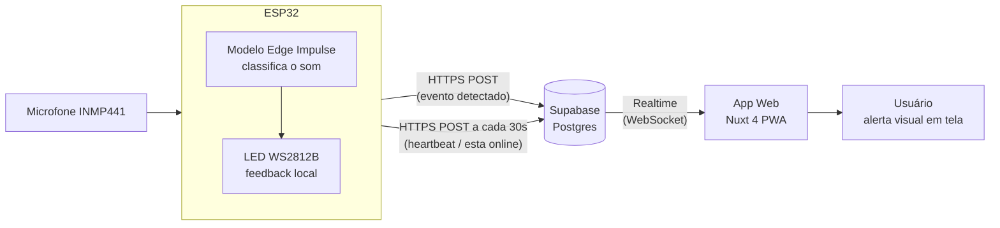

# Alerta de Sons ESP32

Sistema de acessibilidade: um ESP32 com microfone detecta sons (campainha,
palma) usando um modelo do Edge Impulse e manda o evento para o Supabase.
Um app web (PWA em Nuxt 4) mostra, em tempo real, um alerta visual gigante
em tela (icone + texto grande + flash), junto com historico e status de
cada ESP32 (online/offline).

## Como o sistema funciona (visão geral)



1. O microfone (INMP441, via I2S) captura áudio continuamente no ESP32.
2. O modelo treinado no Edge Impulse classifica cada janela de áudio como
   `palma`, `campainha` ou `ruído`.
3. Ao detectar `palma` ou `campainha` com confiança suficiente, o ESP32
   grava o evento na tabela `eventos` do Supabase (via HTTPS/REST) e pisca
   o LED local.
4. A cada 30 segundos, o ESP32 também atualiza a tabela `nodes` com um
   "sinal de vida" (heartbeat), independente de ter detectado som ou não.
5. O Supabase distribui essas mudanças em tempo real (Realtime, via
   WebSocket) para quem estiver com o app aberto.
6. O app web (PWA em Nuxt) escuta esse canal e, ao chegar um evento nesse
   momento: pisca a tela inteira com ícone e texto grande, guarda no
   histórico e atualiza o status online/offline do nó.

## Tecnologias usadas

- **ESP32 + Arduino/C++**: leitura do microfone via I2S, controle do LED
  WS2812B e comunicação HTTPS com o Supabase.
- **Edge Impulse**: treinamento e inferência do modelo de classificação de
  som (embarcado no firmware via a biblioteca `alerta-sons_inferencing`).
- **Supabase**: banco Postgres gerenciado, API REST automática (PostgREST),
  Realtime (WebSocket) e Row Level Security (RLS).
- **Nuxt 4 (Vue 3)**: framework do app web, como PWA (`@vite-pwa/nuxt`).
- **TypeScript**: tipagem do código do app web.
- **pnpm/npm**: gerenciador de pacotes do app web.

## Estrutura do projeto

- `firmware/alerta-sons-esp32.ino`: codigo do ESP32 (Arduino).
- `app/app.vue`: tela principal do app web.
- `plugins/supabase.client.ts`: cliente do Supabase usado pelo app.
- `supabase/schema.sql`: script para configurar o banco no Supabase.

## 1. Configurar o Supabase (passo a passo)

Você já criou o projeto no Supabase, agora falta só isso:

1. Entre no painel do seu projeto em [supabase.com](https://supabase.com).
2. No menu lateral, abra **SQL Editor** e clique em **New query**.
3. Cole todo o conteúdo do arquivo `supabase/schema.sql` deste repositório e
   clique em **Run**. Isso cria as tabelas `eventos` e `nodes`, libera o
   acesso necessário e ativa o tempo real.
4. Vá em **Project Settings -> Data API** (ou **API** em versões mais
   antigas) e copie:
   - o **Project URL**;
   - a chave **anon public** (nunca a `service_role`).

Esses dois valores são usados tanto no app web quanto no firmware do ESP32.

## 2. Configurar o app web

Crie um arquivo `.env` na raiz do projeto (copie de `.env.example`):

```bash
NUXT_PUBLIC_SUPABASE_URL=https://<seu-projeto>.supabase.co
NUXT_PUBLIC_SUPABASE_KEY=<chave anon/publishable>
```

Instale as dependências e suba o app:

```bash
pnpm install
pnpm dev
```

O app abre em `http://localhost:3000`.

> Requer Node.js 22 ou superior para `pnpm build` funcionar sem erros
> (algumas dependências usam recursos novos do JavaScript). `pnpm dev`
> funciona normalmente em versões mais antigas.

## 3. Configurar o firmware do ESP32

Abra `firmware/alerta-sons-esp32.ino` na Arduino IDE e preencha, no topo do
arquivo:

- `WIFI_SSID` / `WIFI_PASS`: sua rede 2.4 GHz;
- `SUPABASE_URL` / `SUPABASE_KEY`: os mesmos valores do passo 1;
- `NODE_ID`: um nome único para esse ESP32 (ex.: `"no1"`, `"porta"`).

Grave no ESP32. No monitor serial, envie `s 1` para ligar o envio dos
eventos ao Supabase (por padrão ele começa desligado).

O firmware manda, a cada 30 segundos, um "sinal de vida" para a tabela
`nodes` (independente de detectar som ou não), o que permite ao app saber
se aquele ESP32 está online.

## Como funciona o gerenciamento no app

- **Alerta em tela**: ao chegar um evento, a tela inteira pisca com um
  ícone e um texto enorme (campainha ou palma), sem depender só de cor.
- **Histórico**: lista os últimos eventos, com filtro por tipo e por nó.
- **Marcar como visto**: cada evento pode ser marcado como visto, para
  diferenciar do que ainda não foi notado.
- **Status por nó**: mostra se cada ESP32 está online ou offline, com base
  no heartbeat.
