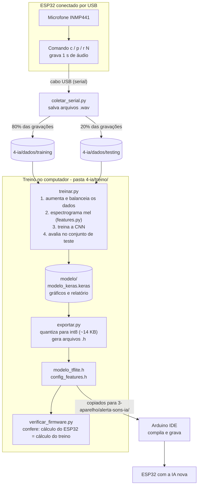
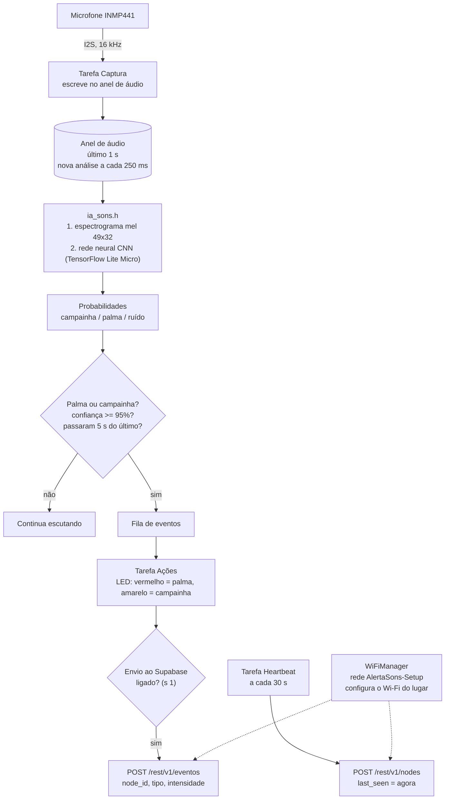
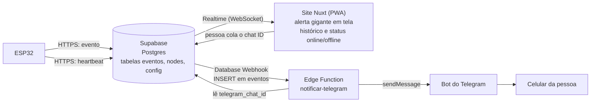
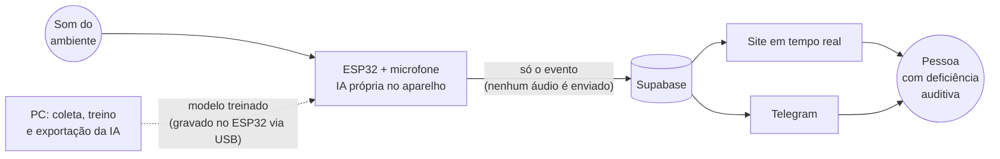

# Diagramas do projeto Alerta de Sons

Os diagramas usam Mermaid (renderizam no GitHub e no VS Code com a extensão
"Markdown Preview Mermaid Support").

## 1. Coleta de sons e treino da IA (acontece no PC)

## 2. Funcionamento do ESP32 (operação normal)

## 3. Da detecção ao alerta no celular e na tela (nuvem)

## 4. Visão geral (tudo junto)

