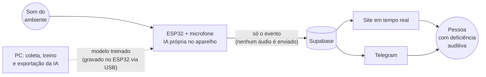
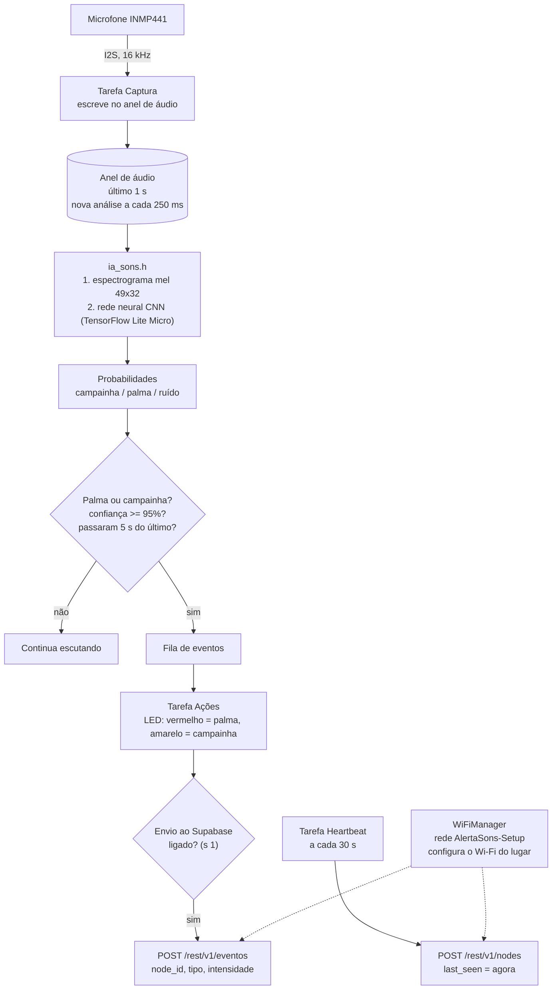
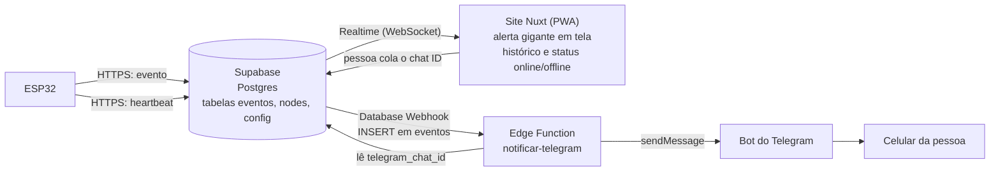
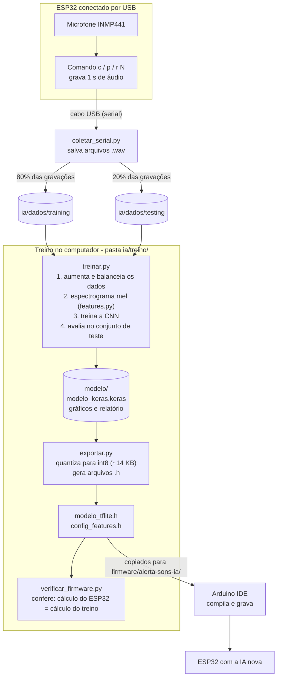
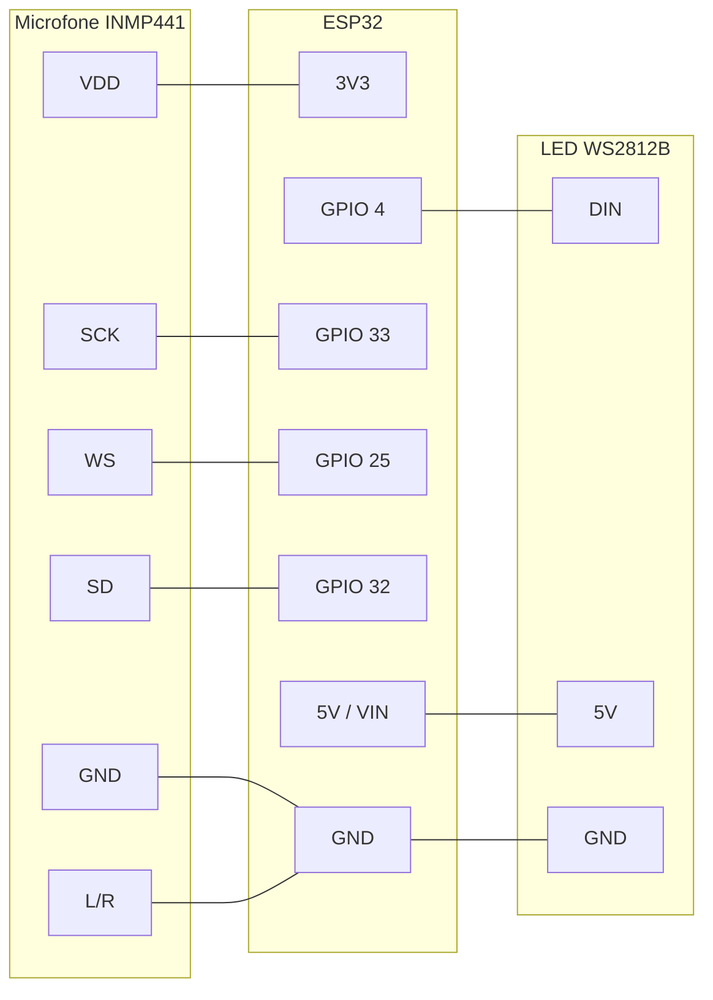
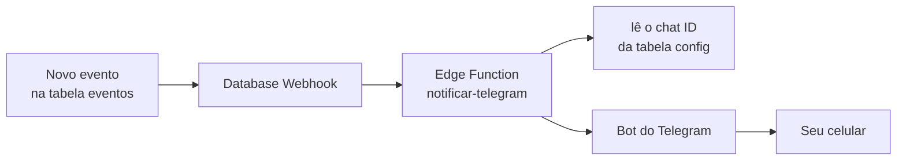
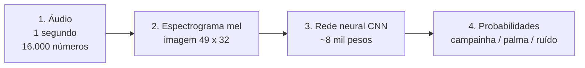

# Manual completo - Alerta de Sons

Este manual leva você do zero até o sistema funcionando: montar o aparelho, ligar o banco
de dados (Supabase), rodar o site, configurar o Telegram, entender como a IA funciona e,
no final, ensinar novos sons (como sirene) ao aparelho.

Não é preciso saber programar para seguir os passos, só copiar e colar os comandos.
Cada etapa tem uma caixa **Conexões** dizendo o que precisa estar ligado a quê.

## Índice

1. [O que é o projeto](#1-o-que-é-o-projeto)
2. [Como tudo funciona (fluxo completo)](#2-como-tudo-funciona-fluxo-completo)
3. [O que você precisa ter](#3-o-que-você-precisa-ter)
4. [Montar o hardware](#4-montar-o-hardware)
5. [Etapa 1 - Ligar o Supabase (banco de dados)](#5-etapa-1---ligar-o-supabase-banco-de-dados)
6. [Etapa 2 - Rodar o site no computador](#6-etapa-2---rodar-o-site-no-computador)
7. [Etapa 3 - Gravar o firmware no ESP32](#7-etapa-3---gravar-o-firmware-no-esp32)
8. [Etapa 4 - Configurar o Telegram](#8-etapa-4---configurar-o-telegram)
9. [Etapa 5 - Testar tudo junto](#9-etapa-5---testar-tudo-junto)
10. [Como a IA foi treinada (didático)](#10-como-a-ia-foi-treinada-didático)
11. [Retreinar com mais dados](#11-retreinar-com-mais-dados)
12. [Adicionar um novo tipo de som (ex.: sirene)](#12-adicionar-um-novo-tipo-de-som-exsirene)
13. [Problemas comuns](#13-problemas-comuns)
14. [Glossário](#14-glossário)

---

## 1. O que é o projeto

Um aparelho de acessibilidade para pessoas com deficiência auditiva. Um ESP32 (um
minicomputador barato com Wi-Fi) com um microfone escuta o ambiente e reconhece **palma** e
**campainha**. Ao reconhecer, ele avisa a pessoa de três jeitos:

- **LED** no próprio aparelho;
- **Site** (app web) com um alerta gigante que pisca na tela;
- **Telegram**, uma mensagem no celular, mesmo com o site fechado.

A inteligência artificial roda **dentro do ESP32**. Nenhum áudio é enviado para a internet:
só o aviso ("campainha, às 14:03").

O aparelho é pensado para ser levado no bolso, usando o hotspot do celular da pessoa e um
powerbank.

## 2. Como tudo funciona (fluxo completo)

### 2.1 Visão geral



### 2.2 Dentro do ESP32 (operação normal)



Em palavras:

1. O microfone entrega 16.000 medições por segundo.
2. A cada 250 ms o ESP32 pega o **último 1 segundo** de áudio e transforma em uma "imagem"
   do som (espectrograma).
3. A rede neural olha a imagem e diz as probabilidades: `campainha`, `palma` ou `ruido`.
4. Se for palma ou campainha com **95% ou mais** de certeza, e se passaram 5 segundos do
   último aviso (para não repetir), o evento é registrado.
5. O LED pisca (vermelho = palma, amarelo = campainha) e, se o envio estiver ligado,
   o evento vai para o Supabase.
6. A cada 30 segundos o ESP32 também manda um "estou vivo" (heartbeat), usado pelo site para
   mostrar online/offline.

### 2.3 Da detecção ao celular e à tela (nuvem)



### 2.4 Como a IA nasce (acontece no PC)



## 3. O que você precisa ter

**Peças**

| Peça | Para quê |
|---|---|
| ESP32 (placa de desenvolvimento, "ESP32 Dev Module") | O cérebro do aparelho |
| Microfone I2S **INMP441** | Captar o som |
| LED endereçável **WS2812B** (2 LEDs, tira ou anel) | Avisar no próprio aparelho |
| Cabo USB (com dados, não só carga) | Gravar o programa e coletar sons |
| Powerbank | Alimentar o aparelho na rua |
| Celular com internet | Hotspot Wi-Fi e Telegram |

**Contas e programas no computador (Windows)**

| O quê | Onde | Para quê |
|---|---|---|
| Conta no [Supabase](https://supabase.com) (gratuita) | site | Banco de dados e nuvem |
| Conta no Telegram | celular | Receber os alertas |
| [Node.js](https://nodejs.org) 22 ou superior | site | Rodar o site |
| [Arduino IDE](https://www.arduino.cc/en/software) 2.x | site | Gravar o ESP32 |
| Pacote de placas **esp32 (Espressif) versão 3.x** | Arduino IDE, Gerenciador de Placas | Compilar para o ESP32 |
| [Python](https://www.python.org/downloads/) 3.12 | site | Treinar a IA (só se for treinar) |
| [Git](https://git-scm.com) | site | Baixar o projeto |

**Baixar o projeto**

```bash
git clone https://github.com/Joao-Strelow/alerta-sons-esp32.git
cd alerta-sons-esp32
```

## 4. Montar o hardware



| Do microfone INMP441 | Para o ESP32 |
|---|---|
| VDD | 3V3 |
| GND | GND |
| SCK | GPIO 33 |
| WS | GPIO 25 |
| SD | GPIO 32 |
| L/R | GND (canal esquerdo; o firmware lê o canal esquerdo) |

| Do LED WS2812B | Para o ESP32 |
|---|---|
| DIN (entrada de dados) | GPIO 4 |
| 5V | 5V (pino VIN/5V da placa) |
| GND | GND |

O firmware espera **2 LEDs**. Se usar outra quantidade, mude `LED_COUNT` no
`alerta-sons-ia.ino`. Os pinos também estão no começo do arquivo (`I2S_SCK`, `I2S_WS`,
`I2S_SD`, `LED_PIN`).

> **Conexões:** o microfone e o LED ligam **só no ESP32**. O ESP32 liga ao computador
> pelo cabo USB (para gravar o programa) e, depois, ao powerbank.

## 5. Etapa 1 - Ligar o Supabase (banco de dados)

O Supabase guarda os eventos e avisa o site em tempo real.

> **Conexões:** nesta etapa você só precisa do **computador com internet**. O ESP32 não precisa
> estar ligado.

### 5.1 Criar o projeto

1. Entre em [supabase.com](https://supabase.com), crie uma conta e clique em **New project**.
2. Dê um nome, defina uma senha do banco (guarde) e escolha uma região próxima.
3. Espere uns minutos até o projeto ficar pronto.

### 5.2 Criar as tabelas

1. No menu lateral, abra **SQL Editor** e clique em **New query**.
2. Abra o arquivo `supabase/schema.sql` deste repositório, copie **todo** o conteúdo e cole
   no editor.
3. Clique em **Run**. Deve aparecer "Success".

Isso cria:

| Tabela | Para quê |
|---|---|
| `eventos` | Cada som detectado: `node_id` (qual aparelho), `tipo`, `intensidade`, `visto`, `created_at` |
| `nodes` | Último "estou vivo" de cada aparelho (`last_seen`), para mostrar online/offline |
| `config` | Uma linha só, com o `telegram_chat_id` de quem recebe os alertas |

Também libera o acesso necessário (RLS) e liga o Realtime (o site recebe os eventos ao vivo).

### 5.3 Copiar a URL e a chave

1. Vá em **Project Settings -> Data API** (ou **API**).
2. Copie o **Project URL** (algo como `https://xxxx.supabase.co`).
3. Copie a chave **anon / publishable**. **Nunca** use a `service_role` no site nem no ESP32.

Guarde os dois. Eles serão usados no site (Etapa 2) e no ESP32 (Etapa 3).

> **Sobre segurança:** as regras criadas deixam qualquer pessoa com a chave pública ler,
> inserir e apagar eventos. Isso é ok para um projeto de estudo. Para uso real com várias
> pessoas, seria preciso restringir o acesso com login.

## 6. Etapa 2 - Rodar o site no computador

> **Conexões:** computador com internet. O site conversa só com o Supabase. O ESP32 não
> precisa estar ligado para o site abrir.

1. Na pasta do projeto, copie o arquivo de exemplo:

   ```bash
   copy .env.example .env
   ```

2. Abra o `.env` e preencha com os valores copiados na Etapa 1:

   ```bash
   NUXT_PUBLIC_SUPABASE_URL=https://<seu-projeto>.supabase.co
   NUXT_PUBLIC_SUPABASE_KEY=<chave anon/publishable>
   ```

3. Instale e rode:

   ```bash
   npm install
   npm run dev
   ```

4. Abra **http://localhost:3000** no navegador.

O site mostra: o alerta gigante que pisca ao chegar um evento, o histórico (com filtro por
tipo e por aparelho, e botão de "visto"), o status online/offline de cada aparelho e o
campo do Telegram.

Para parar o site, aperte `Ctrl + C` no terminal. Sempre que quiser usar, rode
`npm run dev` de novo.

## 7. Etapa 3 - Gravar o firmware no ESP32

> **Conexões:** ESP32 ligado ao **computador por cabo USB**, com o microfone e o LED já
> montados (Seção 4).

### 7.1 Instalar o que o Arduino IDE precisa

1. **Placas:** em **Ferramentas -> Placa -> Gerenciador de Placas**, procure `esp32`
   (Espressif Systems) e instale a versão 3.x.
2. **Bibliotecas:** em **Sketch -> Incluir Biblioteca -> Gerenciar Bibliotecas**, instale:
   - `WiFiManager` (de tzapu)
   - `Adafruit NeoPixel`
   - `Chirale_TensorFLowLite` (o TensorFlow Lite para ESP32)

### 7.2 Abrir e configurar

1. Abra `firmware/alerta-sons-ia/alerta-sons-ia.ino` (os outros arquivos da pasta abrem
   como abas).
2. No topo do arquivo, preencha:

   | Variável | Valor |
   |---|---|
   | `SUPABASE_URL` | O Project URL da Etapa 1 |
   | `SUPABASE_KEY` | A chave anon/publishable da Etapa 1 |
   | `NODE_ID` | Um nome para este aparelho, ex.: `"no1"` (use outro nome em cada aparelho) |

3. Em **Ferramentas**, escolha:
   - **Placa:** `ESP32 Dev Module`
   - **Partition Scheme:** `Huge APP (3MB No OTA/1MB SPIFFS)` (o programa ocupa 99% da
     partição padrão; esta dá folga)
   - **Porta:** a COM do ESP32 (aparece quando ele está ligado no USB)
4. Clique em **Carregar** (seta para a direita). A primeira compilação demora alguns minutos.

> Se ficar em "Connecting..." e travar, segure o botão **BOOT** da placa até começar a
> gravar.

### 7.3 Conectar o Wi-Fi (portal de configuração)

O Wi-Fi **não** fica escrito no código, porque o aparelho muda de lugar.

1. Na primeira vez, o LED fica **azul** e o ESP32 cria uma rede chamada **`AlertaSons-Setup`**.
2. No celular, conecte nessa rede. Uma página abre sozinha (ou acesse `192.168.4.1`).
3. Escolha a rede Wi-Fi (por exemplo, o **hotspot do seu celular**) e digite a senha.
4. O ESP32 guarda a rede. Na próxima vez conecta sozinho. O portal fica aberto até 180 segundos.

Para trocar de rede depois, envie `w` pelo Serial Monitor (abaixo).

> **Conexões em uso:** ESP32 <-> Wi-Fi do celular (hotspot) <-> internet <-> Supabase.

### 7.4 Comandos do Serial Monitor

Abra **Ferramentas -> Monitor Serial** e selecione **115200 baud**. Digite o comando e Enter.

| Comando | O que faz |
|---|---|
| `s 1` / `s 0` | Liga/desliga o envio dos eventos ao Supabase. **Começa desligado**; volta a desligar sempre que o ESP32 reinicia |
| `l 1` / `l 0` | Mostra/oculta as probabilidades em tempo real |
| `w` | Esquece o Wi-Fi e abre o portal de novo |
| `m` | Monitora o nível do microfone (qualquer tecla para parar) |
| `c N`, `p N`, `r N` | Gravam N amostras de campainha, palma ou ruído e mandam pelo USB (usado no treino) |
| `?` | Mostra a ajuda |

Para ver a IA funcionando:

```
l 1
```

Em silêncio você deve ver algo como `campainha=0.00 palma=0.00 ruido=1.00`. Ao bater palmas,
o valor de `palma` sobe.

### 7.5 Cores do LED

| Cor | Significado |
|---|---|
| Azul | Esperando configurar o Wi-Fi |
| Vermelho | Palma detectada |
| Amarelo | Campainha detectada |
| Ciano | Evento enviado ao Supabase com sucesso |
| Rosa | Falha ao enviar |

### 7.6 Ajustar a sensibilidade

No `.ino`, `CONFIANCA_MIN` (padrão `0.95`) é a certeza mínima para disparar.

- Muitos falsos alertas: **suba** (ex.: 0.97).
- Perdendo sons reais: **desça** (ex.: 0.90).

Use `l 1` para decidir com base no que o aparelho realmente "vê". Depois regrave.

## 8. Etapa 4 - Configurar o Telegram

O ESP32 **não** fala com o Telegram. Ele só grava o evento no Supabase. O Supabase chama uma
função (Edge Function) que manda a mensagem.

> **Conexões:** computador com internet (painel do Supabase) + celular com Telegram.
> O ESP32 não precisa estar ligado para configurar.



### 8.1 Criar o bot

1. No Telegram, procure **@BotFather** e envie `/newbot`.
2. Escolha um nome e um usuário (precisa terminar em `bot`).
3. Ele responde com um **token** (algo como `123456:ABC-DEF...`). Guarde e **não compartilhe**.
4. **Importante:** abra a conversa com o seu bot novo e envie `/start`. Sem isso o bot não
   consegue mandar mensagens para você.

### 8.2 Publicar a Edge Function

1. No painel do Supabase, abra **Edge Functions** e crie uma função chamada
   **`notificar-telegram`**.
2. Cole o conteúdo de `supabase/functions/notificar-telegram/index.ts` e publique (Deploy).
3. Em **Edge Functions -> Secrets**, adicione `TELEGRAM_BOT_TOKEN` com o token do passo 8.1.
   (`SUPABASE_URL` e `SUPABASE_SERVICE_ROLE_KEY` já existem sozinhos.)

### 8.3 Ligar o aviso automático (Database Webhook)

1. No painel, vá em **Database -> Webhooks -> Create a new hook**.
2. Tabela: `eventos`. Evento: **Insert**. Tipo: **Supabase Edge Functions**.
   Função: `notificar-telegram`.
3. Salve.

### 8.4 Dizer ao sistema para quem mandar

1. No Telegram, fale com **@userinfobot**. Ele responde com seu **Id** (um número).
2. No site (http://localhost:3000), na seção **Alerta no Telegram**, cole o número e clique
   em **Salvar**.

Esse número fica na tabela `config` (linha única). Hoje o sistema envia para **uma** conversa.

## 9. Etapa 5 - Testar tudo junto

> **Conexões:** ESP32 alimentado (USB ou powerbank) e com Wi-Fi do celular ligado; site
> aberto no computador; Telegram no celular.

Checklist:

1. Abra o Serial Monitor (115200). Deve aparecer "WiFi conectado" e, a cada 30 s,
   `Heartbeat -> 200` (ou 201).
2. Digite `s 1` para ligar o envio ao Supabase.
3. No site, o aparelho deve aparecer como **online**.
4. Bata palmas perto do microfone (ou toque a campainha). Esperado:
   - Serial: `>>> DETECTADO: palma (97%)` e `Supabase POST palma -> 201`;
   - LED vermelho (palma) e depois ciano (enviado);
   - Site: a tela pisca com 👏 PALMA e o evento entra no histórico;
   - Telegram: "👏 Palma detectada, Dispositivo: no1, Horário: ...".

Se algo não funcionar, veja [Problemas comuns](#13-problemas-comuns).

**Uso na rua:** ligue o hotspot do celular com o mesmo nome e senha que você cadastrou no
portal, ligue o aparelho no powerbank e envie `s 1` pelo Serial na primeira vez do dia.
Como o `s 1` volta a desligar ao reiniciar, quem for usar no dia a dia pode mudar
`ENVIAR_SUPABASE_PADRAO` para `true` no `.ino` e regravar.

## 10. Como a IA foi treinada (didático)

### 10.1 A ideia

Em vez de programar regras ("se o som tem tal frequência..."), mostramos **exemplos** e deixamos
o computador descobrir o padrão sozinho. Isso é aprendizado de máquina.

Exemplo: mostramos dezenas de gravações de palma, de campainha e de ruído de fundo, cada uma
com a etiqueta correta. A rede neural ajusta seus números internos (os "pesos") até acertar
as etiquetas.

### 10.2 Passo a passo do que acontece no treino



**1. Coleta.** O próprio ESP32 grava trechos de **1 segundo** (16 kHz, mono) com os comandos
`c`, `p` e `r`, e o script `coletar_serial.py` salva no PC como arquivos `.wav`.
Cada 5ª gravação vai para a pasta de **teste** (20%) e as demais para **treino** (80%).
O nome do arquivo começa com a classe (`palma.12345.wav`).

**2. Espectrograma mel (`features.py`).** A rede não analisa o áudio bruto. Transformamos o
som numa "imagem": no eixo horizontal o tempo (49 colunas) e no vertical as frequências
(32 faixas). Quanto mais claro, mais energia naquela frequência. Uma palma aparece como uma
faixa vertical larga; uma campainha, como linhas horizontais (tons constantes). A escala
**mel** imita o ouvido humano. Passos: dividir o áudio em pedaços de 32 ms, aplicar a
**FFT** (separa o som em frequências), agrupar em 32 faixas mel e aplicar o logaritmo.

**3. Aumento de dados (`dados.py`).** Temos poucos áudios (~400), e redes precisam de muitos
exemplos. Criamos variações: deslocar o som no tempo (±0,2 s), mudar o volume e misturar
ruído de fundo. Também igualamos a quantidade por classe (1.500 de cada), para a IA não
aprender a "chutar ruído". A **validação** é separada *antes* de criar as variações, para
nenhuma cópia de um áudio de treino vazar para a validação.

Um cuidado importante: os primeiros ruídos eram todos de ambientes barulhentos, e o modelo
errava em salas silenciosas. Por isso a classe `ruido` também recebe versões em volume baixo e
ruídos artificiais fracos (incluindo silêncio).

**4. A rede neural (`treinar.py`).** É uma CNN (rede convolucional), boa em reconhecer padrões
em imagens:

| Camada | O que faz |
|---|---|
| Convolução 8 filtros + Pooling | Acha padrões simples (bordas, linhas) e reduz a imagem |
| Convolução 16 filtros + Pooling | Combina em padrões maiores |
| Convolução 32 filtros + Pooling | Padrões ainda mais complexos |
| Reshape (768 números) + Dropout | Achata e "desliga" neurônios ao acaso, para não decorar |
| Densa com N saídas (softmax) | Transforma em probabilidades, uma por classe (somam 100%) |

São só ~8 mil pesos. Isso é o que permite caber num microcontrolador.

**5. Treino.** A rede chuta, compara com a etiqueta certa, mede o erro e ajusta os pesos
(milhares de vezes, em "épocas"). O treino para sozinho quando a validação deixa de
melhorar (*early stopping*).

**6. Avaliação.** Testamos com áudios que a rede **nunca viu** (pasta `testing`). O resultado
é mostrado numa **matriz de confusão**: para cada som real, o que a IA respondeu.

| | Resultado |
|---|---|
| Acurácia no teste (modelo float) | 92,5% |
| Acurácia no teste (modelo int8, o que roda no ESP32) | 90,0% |
| Ruído em volume baixo / silêncio | 100% classificado como ruído |

**7. Quantização int8 (`exportar.py`).** Os pesos são números decimais de 32 bits. Convertemos
para inteiros de 8 bits: o modelo cai para cerca de **14 KB** e roda rápido no ESP32, com
pouca perda de precisão.

**8. Exportação para o ESP32.** O `exportar.py` gera dois arquivos `.h`:

| Arquivo | Conteúdo |
|---|---|
| `modelo_tflite.h` | O modelo (a rede treinada) |
| `config_features.h` | Parâmetros e tabelas do espectrograma, a lista de classes e a normalização |

**9. Conferência (`verificar_firmware.py`).** O ESP32 precisa calcular o espectrograma
**exatamente** como o treino. Este script replica a conta do firmware e compara; a diferença
máxima é de 1 unidade na escala int8.

### 10.3 Ferramentas usadas

| Ferramenta | Para quê |
|---|---|
| Python 3.12 | Linguagem do treino |
| TensorFlow / Keras | Criar e treinar a rede neural |
| TensorFlow Lite | Converter e reduzir o modelo (int8) |
| TensorFlow Lite Micro (`Chirale_TensorFLowLite`) | Rodar o modelo dentro do ESP32 |
| NumPy / SciPy | Contas com áudio, leitura dos `.wav` |
| Matplotlib | Gráficos de treino e matriz de confusão |
| pyserial | Receber os áudios gravados pelo ESP32 via USB |

### 10.4 Mapa dos arquivos de treino

| Arquivo (`ia/treino/`) | Função |
|---|---|
| `config.py` | Todos os parâmetros num só lugar (classes, tamanho do áudio, épocas...) |
| `features.py` | Áudio -> espectrograma mel |
| `dados.py` | Leitura dos `.wav`, separação e aumento de dados |
| `treinar.py` | Cria, treina e avalia a rede; gera gráficos e relatório |
| `exportar.py` | Quantiza para int8 e gera os `.h` |
| `verificar_firmware.py` | Confere se o ESP32 calcula igual ao treino |
| `coletar_serial.py` | Grava novos sons pelo ESP32 e salva em `ia/dados/` |

Os resultados ficam em `ia/modelo/`: `relatorio_treino.txt`, `grafico_treino.png`,
`matriz_confusao.png`, `modelo_alerta.tflite` e os arquivos `.h`.

## 11. Retreinar com mais dados

Quanto mais variados os exemplos reais, melhor o resultado. Vale gravar: sala quieta, TV ou
ventilador ligados, rua, e o aparelho dentro do bolso ou da bolsa.

> **Conexões:** ESP32 com o programa gravado e ligado ao **computador por cabo USB**.
> O **Serial Monitor do Arduino IDE precisa estar fechado** (ele ocupa a porta).

### 11.1 Preparar o Python (uma vez só)

Dentro da pasta `ia` (PowerShell):

```powershell
python -m venv .venv
.\.venv\Scripts\python.exe -m pip install -r requirements.txt
```

### 11.2 Gravar novos sons

Descubra a porta COM do ESP32 (no Arduino IDE, em Ferramentas -> Porta). Exemplos com COM3:

```powershell
.\.venv\Scripts\python.exe treino\coletar_serial.py COM3 palma 30
.\.venv\Scripts\python.exe treino\coletar_serial.py COM3 campainha 30
.\.venv\Scripts\python.exe treino\coletar_serial.py COM3 ruido 60
```

O número é a quantidade de gravações de 1 segundo. Faça o som (ou deixe o ambiente com o
barulho de fundo desejado, no caso do ruído) durante toda a coleta. Os arquivos vão
para `ia/dados/training` (80%) e `ia/dados/testing` (20%).

### 11.3 Treinar e exportar

```powershell
.\.venv\Scripts\python.exe treino\treinar.py
.\.venv\Scripts\python.exe treino\exportar.py
.\.venv\Scripts\python.exe treino\verificar_firmware.py
```

Veja `modelo/relatorio_treino.txt` e `modelo/matriz_confusao.png`. Se a acurácia no teste
subiu (ou se manteve com mais variedade), siga em frente.

### 11.4 Colocar no ESP32

1. Copie `ia/modelo/modelo_tflite.h` e `ia/modelo/config_features.h` para
   `firmware/alerta-sons-ia/` (substituindo os existentes).
2. Abra o `.ino` no Arduino IDE e grave de novo (Etapa 3).
3. Teste com `l 1` no Serial Monitor.

## 12. Adicionar um novo tipo de som (ex.: sirene)

Adicionar uma classe quase não pesa no ESP32: cada classe nova acrescenta só ~768 pesos na
última camada. O modelo continua com poucos KB.

O que muda: o **treino**, o **firmware**, o **site** e a **mensagem do Telegram**. O banco
(Supabase) **não** muda: a coluna `tipo` aceita qualquer texto.

Vamos usar `sirene` como exemplo e a letra `i` como comando de gravação no ESP32 (as letras
`c`, `p`, `r` e `s` já são usadas; escolha uma letra livre).

> Use nomes simples, em minúsculas, **sem acentos nem espaços** e com no máximo 15
> caracteres (o firmware guarda o tipo num texto de 16 posições).

### 12.1 Ensinar o ESP32 a gravar a nova classe

Em `firmware/alerta-sons-ia/alerta-sons-ia.ino`, procure o trecho dos comandos de gravação
(`if (nome == "c" || nome == "p" || nome == "r")`) e acrescente a letra `i`:

```cpp
if (nome == "c" || nome == "p" || nome == "r" || nome == "i") {
  ...
  const char* label = (nome == "c") ? "campainha" : (nome == "p") ? "palma"
                    : (nome == "i") ? "sirene" : "ruido";
```

Na função `mostrarAjuda()`, acrescente a linha de ajuda `i N = gravar N amostras de sirene`.

### 12.2 Ensinar o script de coleta

Em `ia/treino/coletar_serial.py`, no dicionário de letras, acrescente a sirene:

```python
letra = {"campainha": "c", "palma": "p", "ruido": "r", "sirene": "i"}[classe]
```

### 12.3 Declarar a classe no treino

Em `ia/treino/config.py`:

```python
CLASSES = ["campainha", "palma", "sirene", "ruido"]
```

O treino, a rede (camada final) e os arquivos `.h` se ajustam sozinhos ao número de classes
(`IA_CLASSES` é regenerado).

### 12.4 Gravar a sirene e treinar

Grave o firmware do passo 12.1 (Etapa 3). Depois, com o Serial Monitor fechado:

```powershell
.\.venv\Scripts\python.exe treino\coletar_serial.py COM3 sirene 40
```

Procure gravar de 40 a 50 amostras, com distâncias, volumes e locais diferentes (e até sirenes
de fontes distintas: tocando num celular, por exemplo). Depois treine e exporte:

```powershell
.\.venv\Scripts\python.exe treino\treinar.py
.\.venv\Scripts\python.exe treino\exportar.py
.\.venv\Scripts\python.exe treino\verificar_firmware.py
```

Olhe a matriz de confusão. Se a sirene for muito confundida com campainha, grave mais exemplos
de cada. Se mesmo assim não melhorar, dá para aumentar o número de filtros das camadas em
`treinar.py` (custa algumas dezenas de KB no ESP32).

### 12.5 Fazer o ESP32 reagir à nova classe

Copie `modelo_tflite.h` e `config_features.h` para `firmware/alerta-sons-ia/`. No `.ino`:

**a)** Em `tratarDeteccao`, aceite o novo tipo:

```cpp
else if (strcasecmp(label, "sirene") == 0) tipo = "sirene";
```

**b)** Na tarefa de ações, escolha uma cor para o LED. Hoje o código distingue só palma de
campainha; troque por:

```cpp
if (strcmp(ev.tipo, "palma") == 0)          piscar(255, 0, 0, 3, 120);     // vermelho
else if (strcmp(ev.tipo, "sirene") == 0)    piscar(160, 0, 255, 3, 120);   // roxo
else                                        piscar(255, 180, 0, 3, 120);   // amarelo
```

Regrave o ESP32.

### 12.6 Site e Telegram

**Site** (`app/app.vue`):

- Em `ICONES`, acrescente `sirene: '🚨',` (junto de campainha e palma).
- No filtro de tipo, acrescente `<option value="sirene">Sirene</option>` (ao lado das opções
  de Campainha e Palma).
- Nos estilos, acrescente a cor do alerta em tela (junto de `.flash.palma`):

  ```css
  .flash.sirene { background: #7c3aed; color: #fff; }
  ```

**Telegram** (`supabase/functions/notificar-telegram/index.ts`): em `TEXTOS`, acrescente
`sirene: '🚨 Sirene detectada',` e publique a função de novo (cole o arquivo no editor de
Edge Functions do Supabase e clique em Deploy).

### 12.7 Testar

Com `l 1` ligado, toque uma sirene perto do microfone e veja `sirene=0.9x` subir. Em seguida
verifique `s 1`, o LED roxo, o alerta no site e a mensagem no Telegram.

## 13. Problemas comuns

| Sintoma | Causa provável | O que fazer |
|---|---|---|
| LED azul fixo | O ESP32 está esperando você configurar o Wi-Fi | Conecte na rede `AlertaSons-Setup` e escolha o Wi-Fi |
| Não aparece a rede `AlertaSons-Setup` | Ele já tem um Wi-Fi salvo | Envie `w` no Serial para esquecer a rede |
| Upload trava em "Connecting..." | A placa não entrou no modo de gravação | Segure o botão BOOT enquanto grava; troque o cabo (precisa ser de dados) |
| "Sketch too big" | Partição padrão pequena | Ferramentas -> Partition Scheme -> Huge APP |
| Não aparece a porta COM | Cabo só de carga ou falta driver | Troque o cabo; instale o driver CP210x/CH340 da sua placa |
| `Supabase POST ... -> -1` | Sem internet ou pouca memória para a conexão segura | Confira o hotspot; reinicie o ESP32 |
| `Supabase POST ... -> 401/403` | Chave errada | Confira `SUPABASE_KEY` (anon/publishable) |
| `Supabase POST ... -> 404` | Tabelas não criadas | Rode o `schema.sql` (Etapa 1) |
| Nada chega ao site, mas Serial mostra 201 | Realtime desligado ou `.env` errado | Rode o `schema.sql` de novo; confira o `.env` e reinicie `npm run dev` |
| Eventos nem são detectados | Envio desligado | Digite `s 1` (volta a desligar a cada reinício) |
| Telegram não recebe | Faltou `/start` no bot, chat ID errado, token errado ou webhook ausente | Refaça a Etapa 4; veja os *Logs* da Edge Function no Supabase |
| Falsos alertas | Limiar baixo ou ambiente parecido com o som | Suba `CONFIANCA_MIN`; grave mais ruído real e retreine |
| Palma/campainha não é detectada | Limiar alto ou poucos dados | Desça `CONFIANCA_MIN`; grave mais exemplos reais e retreine |
| `coletar_serial.py` diz "Acesso negado" | O Serial Monitor está aberto | Feche o Serial Monitor |
| Treino dá erro de TensorFlow | Versão do Python | Use Python 3.12 e instale pelo `requirements.txt` |

## 14. Glossário

| Termo | Significado |
|---|---|
| **ESP32** | Microcontrolador barato com Wi-Fi e Bluetooth |
| **INMP441** | Microfone digital que fala o protocolo I2S |
| **I2S** | Forma de o microfone mandar o áudio digital ao ESP32 |
| **WiFiManager** | Biblioteca que cria o portal para configurar o Wi-Fi sem mexer no código |
| **Heartbeat** | "Estou vivo" enviado a cada 30 s |
| **Supabase** | Serviço de banco de dados na nuvem (Postgres) com tempo real |
| **RLS** | Regras de quem pode ler/escrever em cada tabela |
| **Realtime** | O site recebe os dados no momento em que são gravados |
| **Edge Function** | Pequeno programa que roda na nuvem do Supabase |
| **Database Webhook** | Gatilho: "quando entrar uma linha nesta tabela, chame esta função" |
| **Espectrograma** | Gráfico de quanta energia há em cada frequência ao longo do tempo |
| **FFT** | Cálculo que separa um som nas frequências que o compõem |
| **Escala mel** | Escala de frequências que imita a percepção do ouvido humano |
| **CNN** | Rede neural com camadas "convolucionais", boas em reconhecer padrões em imagens |
| **Época** | Uma passada completa da rede por todos os exemplos de treino |
| **Overfitting** | Quando a rede "decora" os exemplos e erra em sons novos |
| **Data augmentation** | Criar variações dos dados para a rede generalizar melhor |
| **Matriz de confusão** | Tabela que mostra, para cada som real, o que a IA respondeu |
| **Quantização** | Reduzir a precisão dos números (32 -> 8 bits) para o modelo caber no ESP32 |
| **TensorFlow Lite Micro** | Versão do TensorFlow que roda em microcontroladores |
| **PWA** | Site que se comporta como aplicativo |
